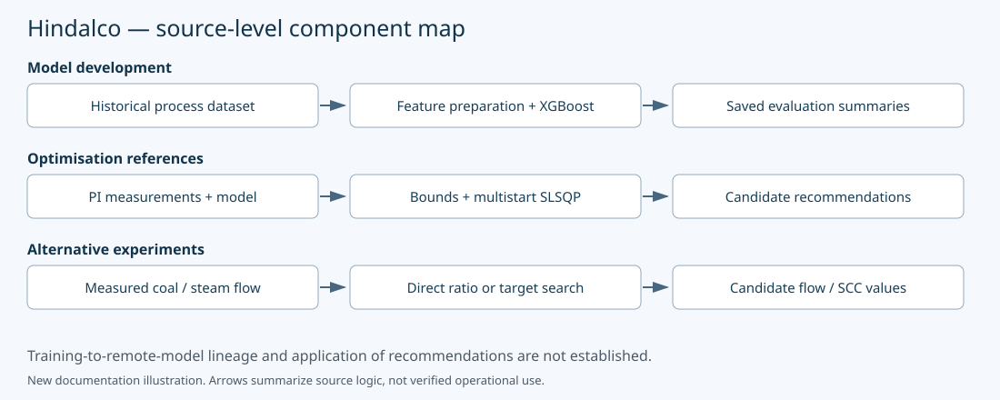

# Boiler Performance Modelling & Constrained Optimisation

**Boiler-efficiency and specific coal consumption development work in the context of a CereBulb client project for Hindalco/Utkal.**

This repository organizes historical model-development notebooks, heat-loss calculations, alternative constrained optimization formulations, adaptive-bound experiments and PI Web API integration references. The contributor describes their role as **adapting and optimizing team-provided implementations**; the collection is not presented as wholly original, solely authored code.

> **Scope:** sanitized source and technical documentation. No credentials, plant tag identifiers, raw industrial datasets, private service endpoints or production model artifacts are included. Reference integrations are deliberately stored as `.py.txt`. This is not a runnable plant-control deployment.



## The industrial problem

Boiler operation involves interacting fuel, air, steam, water and thermal variables. The development work explores two related objectives:

1. Estimate boiler efficiency and specific coal consumption from process measurements.
2. Search for candidate operating points with improved model output or a selected coal/steam ratio while satisfying coded operating constraints.

The source includes both physics-inspired loss equations and statistical models. It also shows why a numerically acceptable solution is not automatically an attainable plant state: many measured or derived quantities are optimized independently, constraint checks vary by version, and a validated dynamic process model is absent.

## Work represented and contribution context

The supplied files support technical discussion of:

- Preparing process measurements and analyzing correlations, multicollinearity and feature importance.
- Developing separate XGBoost workflows for efficiency and SCC prediction, with MLflow logging.
- Implementing twelve labeled loss terms and a 28-variable candidate formulation.
- Exploring fixed-bound, multistart, adaptive-bound, direct-ratio and target-ratio optimization alternatives.
- Building API-reading, aggregation, prediction and recommendation-writing logic.
- Investigating constraint compatibility, current-value deviation limits and fallback behavior.

The user confirms that some baseline work came from the team and that their contribution involved optimization/adaptation. The exact files or individual functions personally authored versus inherited are not independently established. This README does not claim leadership, sole ownership, certified safety, live commissioning or measured fuel savings. See [contribution and evidence](docs/CONTRIBUTION.md).

## Repository map

| Directory | Contents |
|---|---|
| [notebooks/](notebooks/) | Model development and optimization notebooks, with all outputs and private metadata removed |
| [reference/efficiency/](reference/efficiency/) | Explicit heat-loss calculations and efficiency-model maximization |
| [reference/fixed_bounds/](reference/fixed_bounds/) | Baseline operating-point searches under fixed limits |
| [reference/multistart/](reference/multistart/) | Repeated SLSQP searches from different initial points |
| [reference/adaptive/](reference/adaptive/) | Hourly, one-minute, five-minute and live-input-seeded alternatives |
| [reference/direct_scc/](reference/direct_scc/) | Direct SCC, target-distance and constant-target experiments |
| [reference/monitoring/](reference/monitoring/) | API measurement plotting utilities |
| [reference/diagnostics/](reference/diagnostics/) | Measurement and model-input comparison |
| [reference/configuration/](reference/configuration/) | Anonymized mapping shapes; not valid plant configuration |
| [docs/](docs/) | Source guide, inventory, mathematics, evidence and known limitations |

The [complete inventory](docs/file_inventory.csv) maps original filenames, checkpoint/archive copies and exclusions to these destinations. The [source guide](docs/SOURCE_GUIDE.md) lists responsibilities, limitations and original function line ranges. Distinct source variants are retained; exact or output-only duplicates are not counted as new work.

## Data and model development

The supplied boiler CSV contains **110,156 records and 60 columns**. Its filename is referenced by the development notebook's object-storage loading code, but identity between the local file and the historical remote training object has not been established. The aggregate size is project-data scope, **not a claim that every row was used for training**.

The notebook includes timestamp parsing, numeric conversion, selected missing-value handling, negative-value handling, ratio calculations, range-related inspection/filtering, correlation analysis, VIF diagnostics and XGBoost gain-based feature importance. Emissions-unit-conversion formulas in one cell are commented out, so they are not claimed as executed preprocessing.

Two selected-feature training workflows are present:

| Model | Explicit configuration | Evaluation in code |
|---|---|---|
| Boiler efficiency | XGBoost, 250 estimators, learning rate 0.01, depth 3, reg_alpha 0.1 | Random 80/20 split, split seed 42 |
| SCC | XGBoost, 100 estimators, learning rate 0.02, seed 42 | Random 80/20 split, split seed 42 |

RMSE, MAE and R-squared are calculated for training and test subsets and logged with MLflow. Imported libraries are not automatically counted as methods used.

### Saved evaluation evidence

The original larger checkpoint and archive notebook contain the following saved test outputs:

| Model | RMSE | MAE | R-squared |
|---|---:|---:|---:|
| Efficiency | 0.1160 | 0.0892 | 0.9114 |
| SCC | 0.0065 | 0.0049 | 0.9324 |

Source: original `Boiler_1 Model (2)-checkpoint.ipynb`, zero-based cells **44 and 67**, also present in the archive notebook. These are transcribed saved outputs, **not reproduced results**. RMSE/MAE are in stored target units; physical units need verification. No raw notebook output is distributed. See [evaluation provenance](docs/EVALUATION.md).

Random splitting of time-series process data does not establish future-period generalization. Feature construction, possible target-related inputs, filtering and temporal overlap need further validation. No prospective accuracy, plant fuel saving or applied-recommendation benefit is claimed.

## Optimization formulations

### A. Heat-loss-based efficiency modeling

The principal loss implementation contains **28 candidate variables**, twelve labeled loss terms and a **15-feature** model input. The labels include dry flue gas, moisture in fuel, hydrogen in fuel, moisture in air, partial combustion, unburnt ESP/bottom-ash, sensible ESP/bottom-ash, radiation, blowdown and mill rejection.

The optimization minimizes negative model-predicted efficiency. It does not constrain that prediction to equal `100 - total_loss`. Several loss terms are fixed constants; some independent model inputs describe the same physical concepts as calculated losses without equality constraints reconciling them.

Source: [heat-loss reference](reference/efficiency/boiler1_heat_loss.py.txt), original lines 301–372. See [mathematics and units](docs/MATHEMATICS.md).

### B. Model maximization under an SCC constraint

The fixed-bound/multistart family minimizes `-model_prediction(x)` while restricting quantities such as air/coal ratio and coal/steam ratio:

```text
coal_flow / steam_flow <= configured SCC maximum
```

In representative versions this maximum is 0.202. It is a coded value, not an independently verified regulatory or safety threshold. Some prediction variables and print labels conflict about whether the model target is SCC or efficiency. The precise mapping to historical MLflow artifacts remains unresolved.

### C. Adaptive operating ranges

The hourly variant uses fourteen sample buffers and 10th/90th percentiles:

```text
spread = P90 - P10
lower  = max(P10 - 0.15 * spread, 0.85 * original_lower)
upper  = min(P90 + 0.15 * spread, 1.15 * original_upper)
```

Selected minimum constraints are then enforced. A final candidate is checked against coded inequality residuals with a tolerance of 1e-6. Representative multistart runs use fifty random initializations.

Important limits: the queues count samples; they do not maintain a timestamp-indexed rolling hour. Successful hourly updates clear the queues. Compatibility testing samples only three random points. Original limits can be expanded by the coded factors. These checks do not certify a physically attainable or safe plant state.

| Original variant | Actual update logic |
|---|---|
| `V2_B3_scc_deployment_UPT1.py` | Hourly; 10th/90th percentiles |
| `1minute.py` | One minute; 5th/95th percentiles |
| `boiler_2_imin.py` | One minute; 5th/95th percentiles |
| `Boiler_2.1minute.py` | Five minutes; 10th/90th percentiles |
| Live-seed variants | Search starts near current values with learned bounds |

The variants are compared by content, not assumed chronological order.

### D. Direct-ratio and target-setting alternatives

- **Direct SCC:** minimizes `coal_flow / steam_flow` under bounds and selected constraints.
- **Target distance:** minimizes the absolute difference between that ratio and a chosen target; includes feasibility diagnostics and fallback logic.
- **Constant target:** sets SCC to a configured constant and calculates coal flow as `target * current_steam_flow`. The main cycle does not perform optimization.

These alternatives are not interchangeable. A ratio can improve mathematically by changing coal or steam variables without establishing that the plant can achieve that combination. The target-distance version can continue to output writing after a final validation warning; therefore, the repository does not claim that every invalid result is blocked in every implementation.

## Integration and intended workflow

The API-based scripts configure measurements, perform batch/cache or individual retrieval, aggregate channels into feature vectors, load a remote model, calculate predictions or candidates, and construct output writes. Representative boiler1 implementations aggregate **24 or 25 measurements into 14 or 15 model features**.

The supplied integration references require private tag mappings, network services and model artifacts that are intentionally absent. A writer function is evidence of integration logic, not proof of live deployment, actuator application or AVEVA MES commissioning. The source also contains disabled TLS verification and uneven validation/error handling.

The data-free architecture diagram distinguishes the implemented script-level flow from the unverified mapping between training runs and deployed model references.

## Known limitations and preserved defects

- Undefined current-SCC variable in the B1 baseline before optimization.
- A missing constraint dictionary key in the minute B3 variant.
- Syntax errors in the heat-loss experiment and measurement-summary script.
- A saved syntax error in an adaptive-bounds notebook.
- Timing comments that disagree with actual sleeps/update intervals.
- Independent optimization of derived ratios and process responses without complete physical consistency equations.
- Inconsistent validation between versions, including a warn-and-continue path.
- Model objectives may be unsuitable for smooth finite-difference local search without further numerical investigation.

No fixes were silently applied to these historical algorithms. Sanitization and packaging changes are documented separately. See [development comparison](docs/DEVELOPMENT.md) and [validation](docs/VALIDATION.md).

## Exploring and publishing

Begin with the model-development notebook, the heat-loss reference, and the hourly adaptive implementation. Dependencies are summarized in [requirements-reference.txt](requirements-reference.txt); this is not a tested version lock. Notebook execution requires unavailable private inputs/services and is not a documented quick-start path. No training, optimization, inference or API calls were executed during packaging.

Original screenshots/plots were extracted to a local review area outside this repository because they may expose process records and identifiers. The included architecture illustration is newly authored documentation, not an original plant screenshot or proof of deployment.

Use **this folder** as the repository root, never its parent collection. Review [publication notes](docs/PUBLICATION_NOTES.md), attribution and redistribution rights before pushing. No Git initialization, commit, remote modification or upload was performed.
